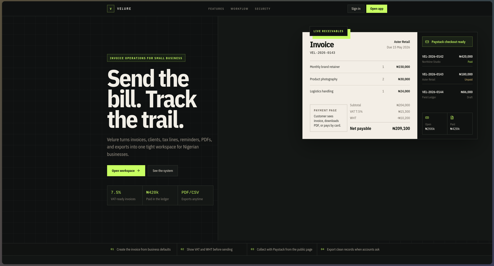
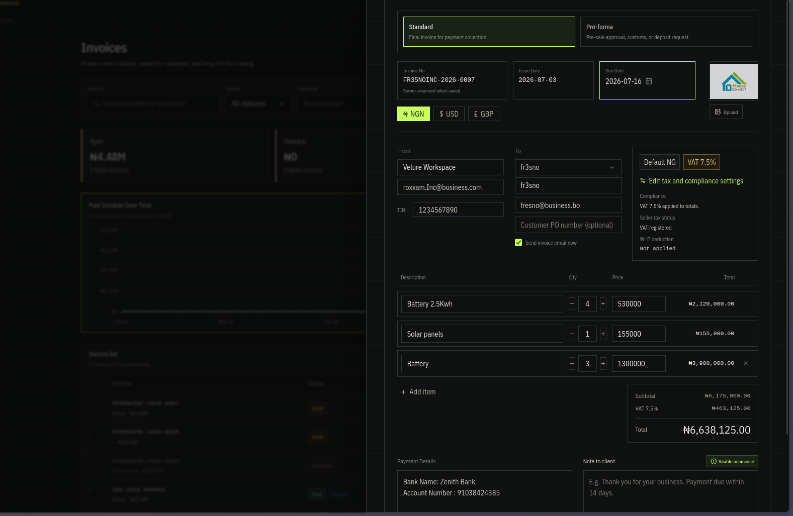
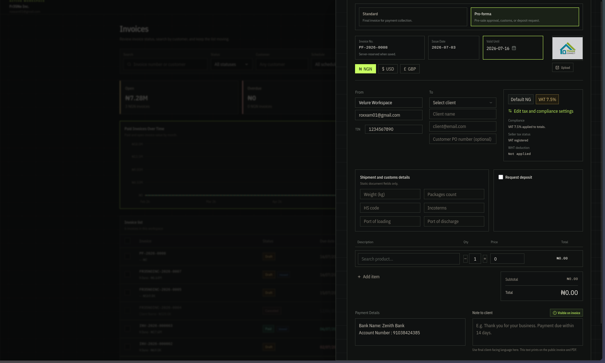
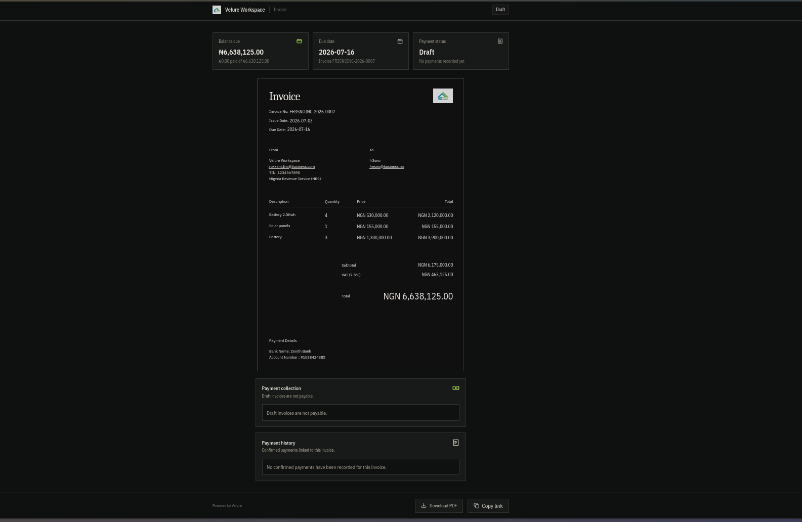
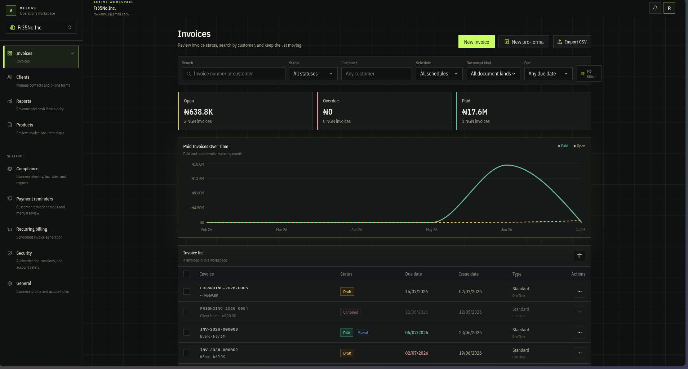
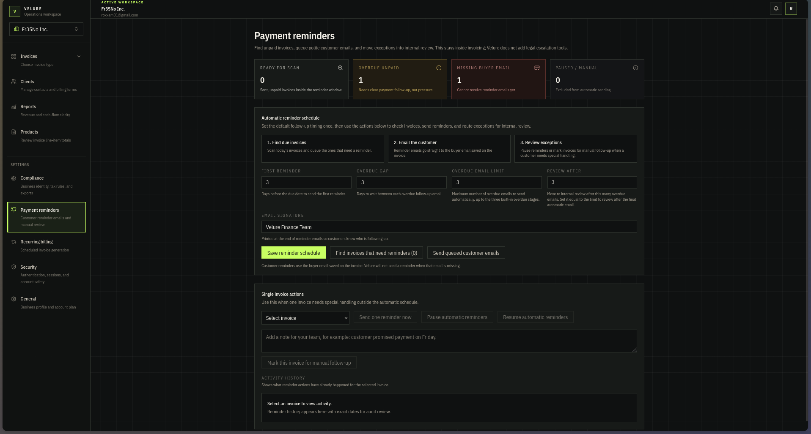
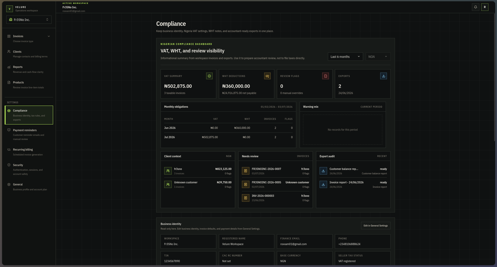
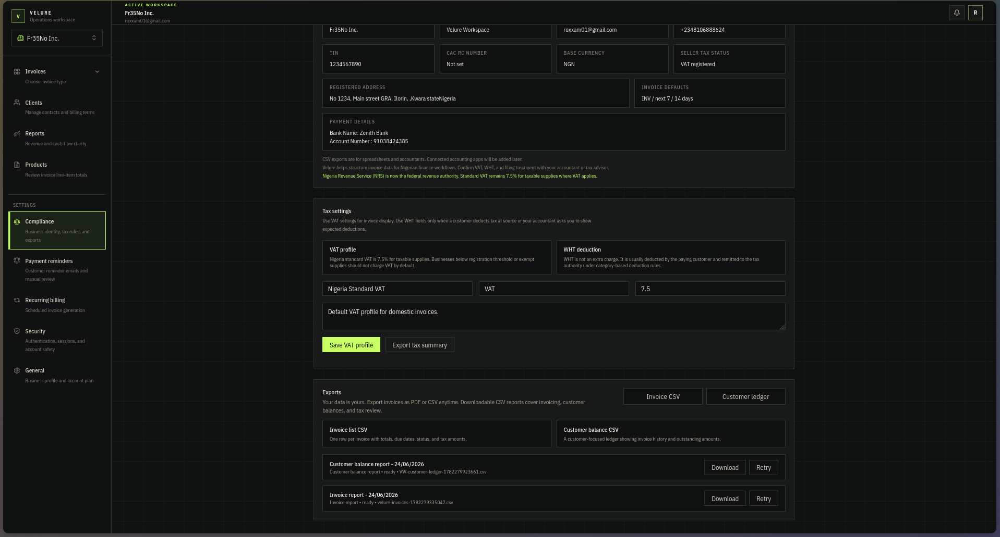
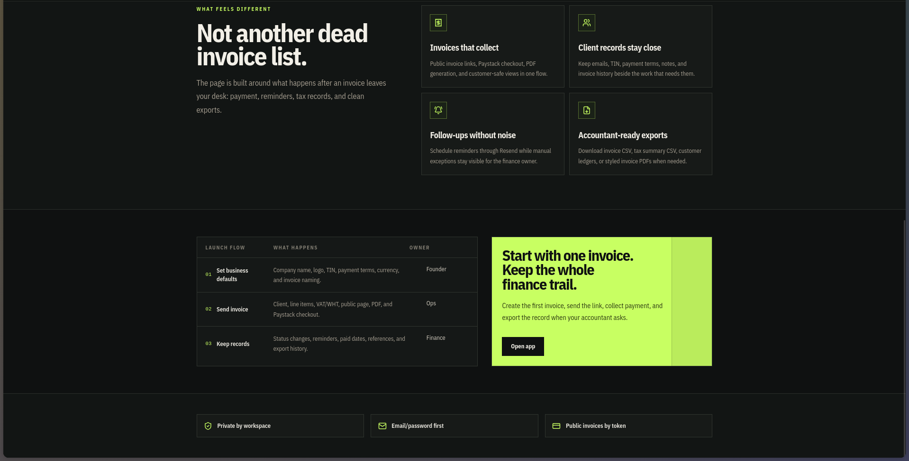

# Velure

Velure is a Nigerian-first invoice operations workspace for small and
mid-sized businesses. It helps teams create professional invoices, manage
clients, collect payments, generate PDFs, send invoice emails, handle VAT/WHT
context, and keep product sales records close to the billing workflow.

Velure is intentionally not an ERP. Product, inventory, reporting, and
integration work stays tied to invoicing, collections, compliance, and
cash-flow clarity.

## Table Of Contents

- [What Velure Handles](#what-velure-handles)
- [Invoice Workflow](#invoice-workflow)
- [Reminders And Compliance](#reminders-and-compliance)
- [Product Boundaries](#product-boundaries)
- [Tech Stack](#tech-stack)
- [Engineering Process](#engineering-process)
- [Local Development](#local-development)
- [Useful Scripts](#useful-scripts)
- [Docker Deployment](#docker-deployment)
- [Current Status](#current-status)
- [Post-Deploy Checklist](#post-deploy-checklist)
- [License](#license)



## What Velure Handles

- Invoice creation for standard and pro-forma documents
- Client records with billing terms, tax details, notes, and invoice history
- Public invoice links with customer-safe invoice views
- PDF generation and invoice email delivery
- Paystack payment collection and payment history
- Nigerian VAT, WHT, TIN, RC, and foreign-currency invoice context
- Product catalog support for faster line-item entry and sales visibility
- Payment reminders, recurring invoice schedules, and accountant-ready exports
- Revenue, compliance, product, and client reporting
- QuickBooks and Xero connection points for accounting continuity

## Invoice Workflow

Velure is built around the movement of an invoice from draft to collection:

1. Set workspace defaults such as business identity, logo, currency, payment
   terms, invoice numbering, and compliance details.
2. Create an invoice from a client record, product line items, due dates,
   payment notes, and VAT/WHT settings.
3. Review totals, tax treatment, document type, and customer details before the
   invoice leaves the workspace.
4. Share the public invoice link, send the PDF by email, or download the PDF
   for manual delivery.
5. Let customers view the invoice, download the PDF, and pay when Paystack is
   configured.
6. Track status, payment amount, paid date, reminders, exports, and reporting
   from the invoice ledger.



The invoice editor keeps document type, invoice number, due date, customer
details, logo, currency, line items, VAT treatment, payment details, and notes
in one focused workspace before the invoice is sent.



Pro-forma invoices support pre-sale approval, customs context, shipment
details, valid-until dates, optional deposit requests, and the same tax and
line-item review flow as standard invoices.



Public invoice pages are token-scoped customer views. Customers can inspect the
invoice, download the PDF, copy the link, and pay when payment collection is
available.



## Reminders And Compliance

Velure keeps follow-up inside the invoice workflow. Payment reminders can scan
for due or overdue invoices, email customers through the configured delivery
provider, and route exceptions for manual review.



Compliance screens summarize Nigerian VAT and WHT exposure, review flags,
business identity, invoice defaults, and export activity. They are designed for
accountant review and billing records, not direct tax filing.





## Product Boundaries

Velure focuses on billing and collections:

- Invoices, clients, payments, public invoice sharing, PDFs, and email delivery
  are core.
- Nigerian compliance support exists to help businesses issue cleaner invoices
  and export finance records.
- Products and lightweight inventory exist only to support invoicing and
  product sales workflows.
- Reporting exists to clarify receivables, revenue, customer behavior, product
  sales, VAT, WHT, and collections.

Velure should not grow into warehouse management, procurement, manufacturing,
payroll, HR, supply-chain software, or a general business operating system.



## Tech Stack

- TanStack Start, TanStack Router, Vite, and Nitro
- React 19 and TypeScript
- Convex for application data, server functions, and Better Auth integration
- Better Auth for email/password sessions and Google OAuth
- Resend for password reset, invoice email delivery, and email webhooks
- Paystack for invoice payment collection
- React PDF for invoice PDF rendering
- Biome, Vitest, and Playwright for quality checks
- pnpm for package management

## Engineering Process

Velure has explicit product and architecture guardrails. Read these before
planning major work:

- [AGENTS.md](AGENTS.md): required agent workflow, mandatory review sections,
  product-scope limits, and Convex guardrails.
- [ProductStrategy.md](ProductStrategy.md): Nigerian-first billing,
  collections, compliance, and cash-flow clarity strategy.
- [Architecture.md](Architecture.md): data-flow-first rule, public/private path
  boundaries, workspace safety, observability, and product-scope protection.

> [!IMPORTANT]
> New product work must stay tied to invoicing, billing, payments, clients,
> public invoice sharing, PDF generation, email delivery, Nigerian compliance,
> product catalog, or lightweight inventory that supports invoicing.

## Local Development

### Prerequisites

- Node.js 20+
- pnpm 10.32.1, preferably through Corepack
- A reachable Convex deployment
- Better Auth credentials for local sign-in flows
- Google OAuth credentials if testing Google sign-in
- Resend credentials if testing email delivery
- Paystack credentials if testing payment collection

### Install

```bash
corepack enable
corepack prepare pnpm@10.32.1 --activate
pnpm install
```

### Configure Environment

Copy `.env.example` to `.env.local` and fill in the values needed for the
flows you are testing.

```bash
cp .env.example .env.local
```

Commonly required values:

| Variable | Purpose |
| --- | --- |
| `CONVEX_DEPLOYMENT` | Convex deployment identifier |
| `VITE_CONVEX_URL` | Convex client URL used by the app |
| `VITE_CONVEX_SITE_URL` | Convex site URL used by the Better Auth bridge |
| `SITE_URL` | Public application origin |
| `BETTER_AUTH_URL` | Better Auth application origin |
| `BETTER_AUTH_BASE_URL` | Optional explicit auth base URL override |
| `BETTER_AUTH_SECRET` | Better Auth signing secret |
| `AUTH_SESSION_VERSION` | Optional version string for invalidating cached auth sessions; bump it after auth provider, session-shape, or account-linking changes |
| `GOOGLE_CLIENT_ID` | Google OAuth client ID |
| `GOOGLE_CLIENT_SECRET` | Google OAuth client secret |
| `RESEND_API_KEY` | Resend API key |
| `RESEND_FROM` | Sender identity for transactional email |
| `RESEND_WEBHOOK_SECRET` | Secret used to verify Resend webhooks |
| `SLACK_WEBHOOK_URL` | Optional reminder escalation webhook |
| `PAYSTACK_SECRET_KEY` | Paystack secret key for payment collection |
| `PAYSTACK_PUBLIC_KEY` | Paystack public key for payment initialization |
| `QUICKBOOKS_CLIENT_ID` | QuickBooks OAuth client ID |
| `QUICKBOOKS_CLIENT_SECRET` | QuickBooks OAuth client secret |
| `QUICKBOOKS_ENV` | `sandbox` or `production` |
| `XERO_CLIENT_ID` | Xero OAuth client ID |
| `XERO_CLIENT_SECRET` | Xero OAuth client secret |

> [!WARNING]
> Never commit real secrets or personal Convex deployment URLs. Keep secrets in
> `.env.local`, Convex environment variables, or your deployment platform's
> secret manager.

> [!NOTE]
> Keep `SITE_URL` and `BETTER_AUTH_URL` aligned with the same public HTTPS
> origin unless you intentionally split auth hosting.

> [!TIP]
> Update Google OAuth callback URLs whenever you move between localhost,
> preview domains, and production domains.

> [!IMPORTANT]
> Treat public invoice pages as token-scoped customer views, not authenticated
> workspace pages. Configure Resend and Paystack webhook secrets before trusting
> production email or payment events.

### Start The App

```bash
pnpm dev
```

The development server runs at `http://localhost:3000`.

The `dev` script runs Convex sync and the Convex API reference guard before
starting Vite. If you add, rename, remove, or consume a Convex query, mutation,
or action, keep that guardrail in place.

## Useful Scripts

```bash
pnpm dev      # Sync Convex functions, verify API refs, and start Vite
pnpm build    # Create the production build
pnpm start    # Run the built Nitro server from .output
pnpm test     # Run Vitest
pnpm check    # Run Biome checks
pnpm exec playwright test  # Run Playwright e2e tests
```

> [!NOTE]
> `pnpm dev` already runs `pnpm run convex:sync` and
> `pnpm run guard:convex-api`. Run those commands manually only when checking
> Convex callable function changes without starting the dev server.

> [!TIP]
> For route-level acceptance checks, start the app on `http://localhost:3000`
> and run `pnpm exec playwright test tests/e2e/route-smoke.spec.ts`.

## Production Build

```bash
pnpm build
PORT=3000 pnpm start
```

The production server serves the Nitro output from `.output`, binds to
`0.0.0.0`, and respects the platform-provided `PORT`.

## Docker Deployment

This repository includes a production `Dockerfile` and `.dockerignore` for
Docker-capable platforms.

### Build locally

```bash
docker build \
  --build-arg VITE_CONVEX_URL=https://your-convex-deployment.convex.cloud \
  --build-arg VITE_CONVEX_SITE_URL=https://your-convex-site.convex.site \
  -t velure .
```

```bash
docker run --env-file .env.local -p 3000:3000 velure
```

> [!WARNING]
> Do not pass private keys, OAuth client secrets, Resend API keys, Paystack
> secret keys, or Better Auth secrets as Docker build args. Build args can be
> captured in image metadata or layers. Use build args only for public Vite
> values such as `VITE_CONVEX_URL` and `VITE_CONVEX_SITE_URL`, then configure
> secrets as runtime environment variables.

### Required runtime settings

Set these on the deployment platform:

- `NODE_ENV=production`
- `CONVEX_DEPLOYMENT`
- `VITE_CONVEX_URL`
- `VITE_CONVEX_SITE_URL`
- `SITE_URL`
- `BETTER_AUTH_URL`
- `BETTER_AUTH_SECRET`
- `GOOGLE_CLIENT_ID` and `GOOGLE_CLIENT_SECRET`, if Google sign-in is enabled
- `RESEND_API_KEY`, `RESEND_FROM`, and `RESEND_WEBHOOK_SECRET`, if email is
  enabled
- `PAYSTACK_PUBLIC_KEY` and `PAYSTACK_SECRET_KEY`, if payment collection is
  enabled
- Accounting integration credentials only when QuickBooks or Xero sync is
  enabled

> [!IMPORTANT]
> The container defaults to `PORT=3000` and `HOST=0.0.0.0`. If your platform
> injects a different `PORT`, let the platform value override the default and
> expose that same port in the service settings.

### Platform guide

Use the same application shape on Sevalla, Render, Railway, Fly.io, or any
Dockerfile-capable host:

1. Push the repository with `Dockerfile` and `.dockerignore`.
2. Create a web service from the Git repository.
3. Select Dockerfile-based deployment and use `Dockerfile` from the repository
   root.
4. Configure public build args for `VITE_CONVEX_URL` and
   `VITE_CONVEX_SITE_URL`.
5. Configure runtime environment variables and secrets from the table above.
6. Set the public domain and update `SITE_URL` and `BETTER_AUTH_URL` to that
   exact HTTPS origin.
7. Update Google OAuth redirect URIs, for example:

```text
https://your-domain.com/api/auth/callback/google
```

8. Configure provider webhooks:
   - Resend: `https://your-domain.com/api/email/resend/webhook`
   - Paystack: `https://your-domain.com/api/payments/paystack/webhook`
9. Deploy, then confirm logs show the Nitro server listening without auth,
   Convex, email, or payment environment errors.

Platform notes:

- Sevalla or similar Docker hosts: choose Dockerfile deployment from the repo
  root, set all runtime environment variables in the dashboard, and expose the
  platform `PORT` or `3000`.
- Render: create a Web Service, choose Docker as the runtime, keep the Docker
  command empty so the `Dockerfile` `CMD` runs, and set build args plus runtime
  secrets in the dashboard.
- Railway: create a service from the repository; Railway detects the
  `Dockerfile`. Add variables in the service environment and attach a public
  domain after deployment.
- Fly.io: deploy from the repository with `fly launch` / `fly deploy`, keep the
  Dockerfile in the root, set secrets with `fly secrets set`, and make sure
  `internal_port` matches the container port you expose.

Official references:

- [Render Docker deployments](https://render.com/docs/docker)
- [Railway Dockerfiles](https://docs.railway.com/builds/dockerfiles)
- [Fly.io app configuration](https://fly.io/docs/reference/configuration/)

## Current Status

Velure is an active product codebase, not a generic starter. The README
describes the intended product surface, but a production rollout still requires
environment-specific verification.

- Auth and session changes should be tested with email/password, Google OAuth,
  protected dashboard routes, and public invoice routes.
- Run a full Biome and Vitest pass before release; Markdown and Docker files are
  ignored by Biome in the current configuration.
- Run Playwright against a real dev server for route smoke, authenticated
  invoice flows, Google auth loader behavior, and payment collection.
- Pro-forma invoice behavior should be checked when shipment, customs, deposit,
  and valid-until fields change.
- Purchase-order, procurement, warehouse, and inventory-operations features
  remain out of scope unless product strategy changes explicitly.

## Post-Deploy Checklist

- Landing page and screenshots load on the public URL.
- `/manifest.json` returns Velure branding and dark theme values.
- Email/password sign-in works.
- Google sign-in returns to the deployed app, not localhost.
- Authenticated users can open invoices, clients, reports, products, and
  settings.
- Invoice creation works for standard and pro-forma documents.
- Public invoice links load from `/i/$token`.
- PDF download works from public invoice pages.
- Invoice email sending works when Resend is configured.
- Paystack payment initialization and webhook confirmation work in the chosen
  environment.
- Reminder, recurring billing, compliance export, and report screens load.
- No auth, webhook, public invoice, or payment flow leaks development URLs.

## License

This repository is proprietary unless a separate license file is added. All
rights are reserved by the project owner.
