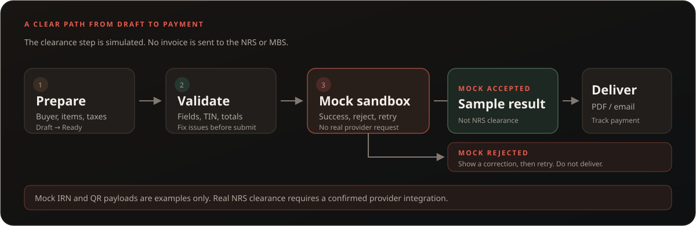
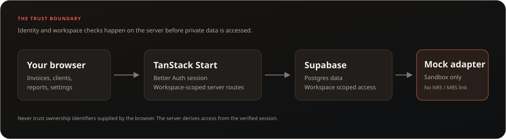

<p align="center">
  
</p>

<h1 align="center">From first draft to paid invoice, with a clear trail.</h1>

<p align="center">
  Velure brings invoicing, customer details, payment follow-ups, and finance records into one focused workspace for Nigerian businesses.
</p>

<p align="center">
  <a href="#what-you-can-do">Explore the product</a> ·
  <a href="#try-it-locally">Run it locally</a> ·
  <a href="docs/e-invoicing/SPEC.md">Read the e-invoicing scope</a>
</p>

<p align="center">
  
</p>

## What you can do

Velure keeps the everyday work around an invoice together:

- Create standard, pro-forma, credit, and debit documents with customer and product details.
- Review line items, tax categories, totals, payment terms, and due dates before delivery.
- Share a customer-safe invoice page, download a PDF, or send an invoice by email.
- Record payments, collect through Paystack when configured, and see what remains outstanding.
- Schedule reminders and recurring invoices, then review the history from the workspace.
- Export invoice and tax summaries for your accountant.

## E-invoicing, explained plainly

Velure includes the groundwork for an e-invoicing workflow: structured invoice data, validation, lifecycle states, an audit trail, a retryable submission queue, and a provider adapter.

**The provider is a mock sandbox. Velure is not NRS-certified, does not submit invoices to the NRS or MBS, and cannot obtain real clearance.** Any sample status, IRN, or QR payload is mock data. Do not treat it as a cleared invoice or a tax filing.

The flow below shows where the simulation ends. A real provider integration needs a confirmed provider, credentials, and its approved production process.


## What sits behind the workspace

The browser talks to the TanStack Start application. Server routes verify the session and workspace before reading or changing business data. E-invoice simulations use the mock adapter; there is no live NRS or MBS connection.



## Built with

- TanStack Start and TanStack Router
- React 19, TypeScript, and Vite
- Supabase Postgres and Better Auth
- Tailwind CSS 4
- Vitest and Biome
- Nitro, with a Cloudflare Pages build target

## Try it locally

### You will need

- Node.js 22 or newer
- pnpm 10.32.1
- A Supabase project or local Supabase stack
- Better Auth and database environment settings

### Start the app

```bash
corepack enable
pnpm install
cp .env.example .env.local
```

Fill in the Supabase URL and publishable key, Better Auth secret and URL, database connection, and the server-side signing settings described in `.env.example`. Add Resend or Paystack credentials only when you want to exercise those integrations. Keep secrets out of commits and screenshots.

```bash
pnpm dev
```

Open [http://localhost:3000](http://localhost:3000).

## Useful checks

```bash
pnpm test       # Unit and integration tests
pnpm typecheck  # TypeScript
pnpm check      # Biome lint and formatting checks
pnpm build      # Production build
pnpm build:pages # Cloudflare Pages build
```

The live Supabase tests need a separately configured test project and are not run by `pnpm test`.

## Project status

The e-invoicing work packages WP1–WP16 are merged. The current milestone builds and tests the workflow with mock provider behavior; it does not deliver NRS or MBS clearance. See the [e-invoicing ledger](docs/e-invoicing/STATE.md) for package status and known verification limits.

Velure stays focused on invoicing, billing, payments, customers, delivery, Nigerian tax context, and lightweight product tools that support selling. It is not an ERP, warehouse, procurement, or payroll system.

## Contributing

Before changing product behavior, read [AGENTS.md](AGENTS.md), the task prompt in `prompts/`, and the relevant section of [the e-invoicing spec](docs/e-invoicing/SPEC.md). Keep tests on mocks; do not send real invoices, email, or provider requests from tests.

## License

No open-source license is currently provided. All rights are reserved by the project owner.
